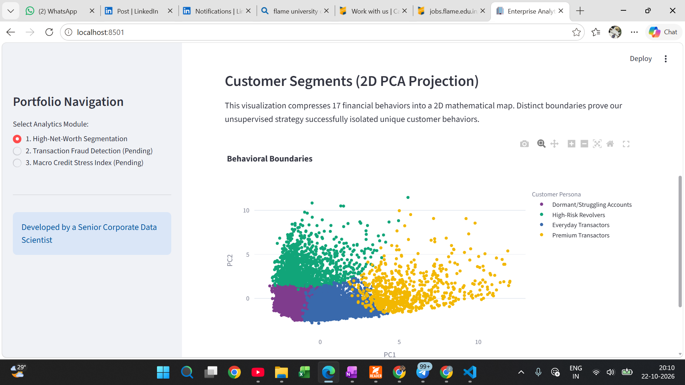
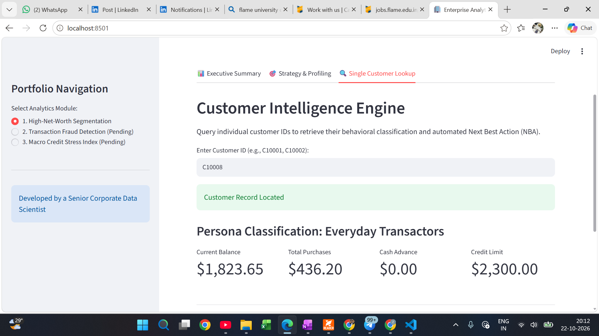

# 💳 Credit Card Customer Segmentation
**Unsupervised Machine Learning for Product Strategy & Risk Mitigation**

## 📌 Table of Contents
- [Project Overview](#project-overview)
- [Business Objectives](#business-objectives)
- [Data Sources](#data-sources)
- [Exploratory Data Analysis & Preprocessing](#exploratory-data-analysis--preprocessing)
- [Models Used](#models-used)
- [Evaluation Metrics](#evaluation-metrics)
- [Application](#application)
- [Project Structure](#project-structure)
- [How to Run This Project](#how-to-run-this-project)
- [Author & Contact](#author--contact)

---

<h2 id="project-overview">🚀 Project Overview</h2>

This project implements an **end-to-end unsupervised machine learning pipeline** designed to support Product and Risk teams by:
1. **Segmenting a credit card portfolio** into distinct, actionable behavioral personas.
2. **Translating abstract mathematical clusters** into targeted business strategies (e.g., premium upgrades, retention campaigns, risk interventions).

<h2 id="business-objectives">🎯 Business Objectives</h2>

**1. Optimized Marketing Spend & Product Personalization:** 
Stop marketing to customers based on basic demographics and transition to behavioral targeting.

* **Objective:** Identify premium spenders and everyday transactors to deploy targeted rewards and cashback multipliers.
* **Why it matters:**
  * Blanket marketing campaigns yield low conversion rates.
  * Premium users are highly profitable via interchange fees and require luxury travel incentives.
  * Targeted engagement increases "share of wallet" for everyday convenience shoppers.



**2. Proactive Credit Risk Mitigation:** 
Automatically detect accounts exhibiting high-risk borrowing behaviors.

* **Objective:** Isolate users who rely heavily on cash advances and make minimum payments to prevent potential defaults.
* **Why it matters:**
  * High-interest cash advances signal severe liquidity stress.
  * Early detection allows the risk team to intervene with structured personal loans before a total default occurs.
  * Suppressing credit line increases for risky segments protects portfolio health.



⚡ **Faster Frontline Operations:** Equip customer service representatives with an automated "Next Best Action" (NBA) engine based on live customer lookups.

<h2 id="data-sources">🗄️ Data Sources</h2>

Data is sourced from a financial credit card dataset (approx. 9,000 active users) detailing 6 months of behavioral metrics:
- **Balances & Limits:** `BALANCE`, `CREDIT_LIMIT`
- **Spending Habits:** `PURCHASES`, `ONEOFF_PURCHASES`, `PURCHASES_TRX`
- **Borrowing & Repayment:** `CASH_ADVANCE`, `MINIMUM_PAYMENTS`, `PRC_FULL_PAYMENT`

<h2 id="exploratory-data-analysis--preprocessing">🔍 Exploratory Data Analysis & Preprocessing</h2>

Key steps taken during EDA and Corporate Data Prep:
- **Outlier Management:** Applied Winsorization (99th percentile capping) to prevent extreme financial outliers (e.g., $50,000 limits) from distorting cluster centroids.
- **Feature Standardization:** Utilized `StandardScaler` to bring dollar amounts and frequencies onto a level mathematical playing field for distance-based algorithms.
- **Multicollinearity Resolution:** Identified highly correlated purchasing features requiring dimensionality reduction.

<h2 id="models-used">⚙️ Models Used</h2>

The pipeline leverages **Scikit-Learn** for robust unsupervised learning:
1. **Dimensionality Reduction (PCA):** 
   - Compressed 17 overlapping features into **8 Principal Components**, retaining >85% of the original behavioral variance while eliminating noise and multicollinearity.
2. **Unsupervised Clustering (K-Means):**
   - Grouped the PCA-compressed data into distinct segments.
   - Extracted 4 actionable business personas maximizing marketing ROI and risk prevention: 
     * *Premium Transactors, High-Risk Revolvers, Everyday Transactors, and Dormant/Struggling Accounts.*

<h2 id="evaluation-metrics">📊 Evaluation Metrics</h2>

- **Elbow Method (WCSS):** Plotted Within-Cluster Sum of Squares to mathematically justify the selection of k=4 clusters.
- **Silhouette Score:** Evaluated cluster density and separation to ensure distinct boundaries between customer personas.
- **2D PCA Projection:** Visually validated cluster integrity by mapping segments onto the top two principal components.

<h2 id="application">🌐 Application</h2>

The project includes a fully interactive, production-grade **Streamlit Web Application** for stakeholders. Users can seamlessly toggle through a 3-tab layout:
- **Executive Summary:** Live portfolio KPIs and an interactive 2D PCA cluster projection.
- **Strategy & Profiling:** Dynamic grouped bar charts comparing individual persona behavior against the global portfolio average, complete with automated strategic recommendations.
- **Customer Intelligence Engine:** A production-simulated lookup tool where reps can input a `CUST_ID` to instantly retrieve a user's persona and an automated Next Best Action (NBA).

<h2 id="project-structure">📁 Project Structure</h2>

```text
├── data/
│   ├── credit_card_data.csv                  # Raw Dataset
│   └── customer_personas_final.csv           # Final Enriched Dataset (PCA + Clusters)
├── notebooks/
│   └── 01_model_training_segmentation.ipynb  # EDA, PCA, K-Means Pipeline
├── images/
│   ├── persona_strategy.png                  # Dashboard Screenshot
│   └── customer_lookup.png                   # Dashboard Screenshot
├── app.py                                    # Streamlit User Interface
└── README.md
```

<h2 id="how-to-run-this-project">💻 How to Run This Project</h2>

1. Clone the repository:
   ```bash
   git clone https://github.com/your-username/your-repo-name.git
   ```
2. Install the required dependencies:
   ```bash
   pip install pandas scikit-learn streamlit plotly
   ```
3. Run the Streamlit app via the terminal:
   ```bash
   streamlit run app.py
   ```

<h2 id="author--contact">🧑‍💻 Author Contact</h2>

**Ahmad Reza**  
*Aspiring Data Analyst – ML | Economics Postgrad (23-25)*  

- 📧 Email: ahmadreza6122@gmail.com  
- 🔗 LinkedIn: [www.linkedin.com/in/ahmad-reza-econ](https://www.linkedin.com/in/ahmad-reza-econ)  
- 🔗 GitHub: [https://github.com/your-username] 
